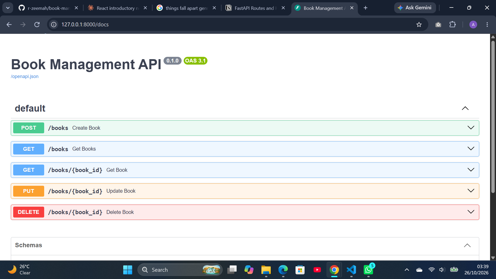
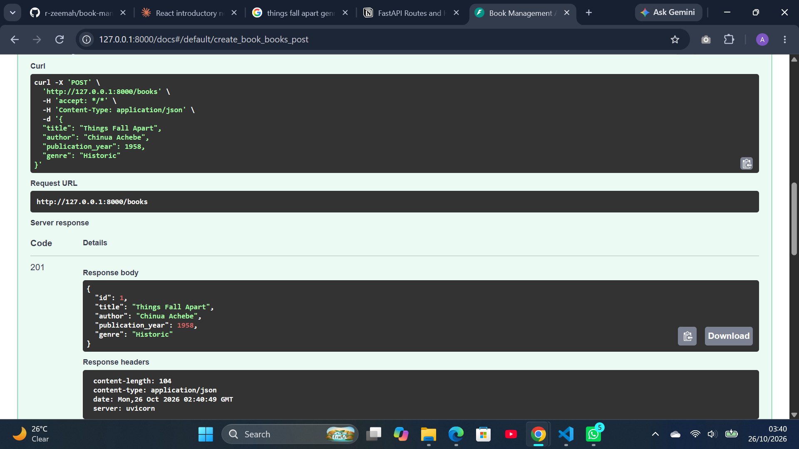
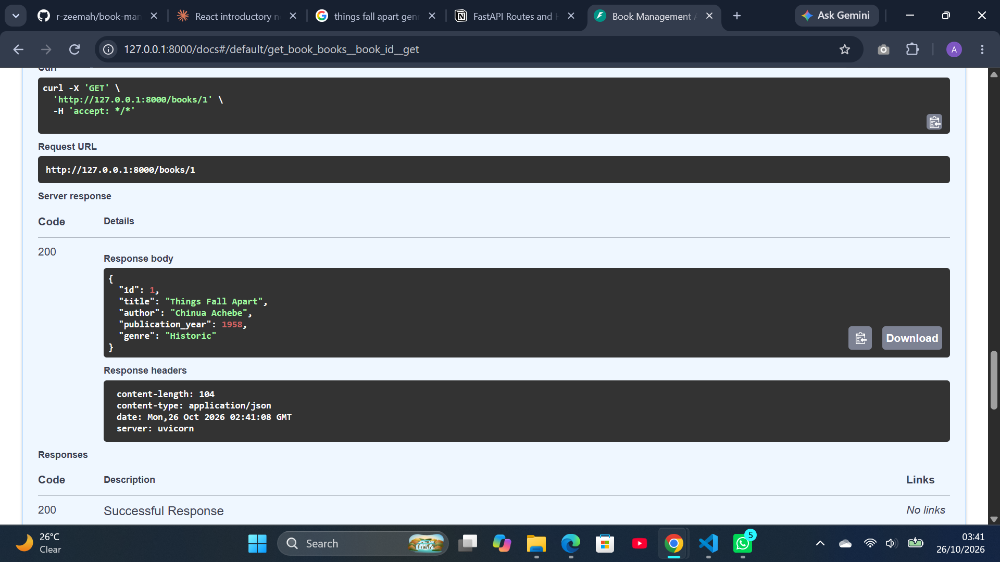
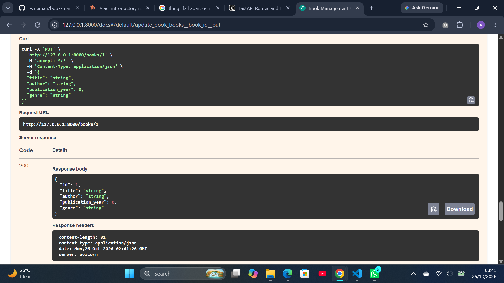
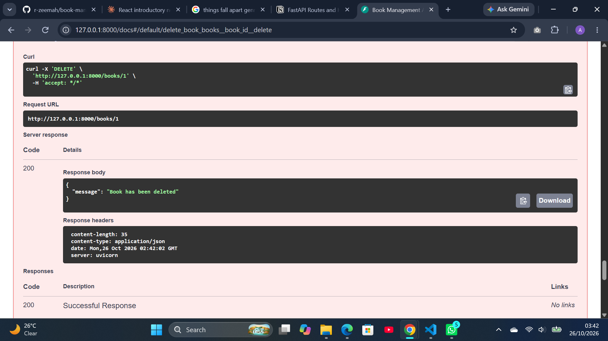
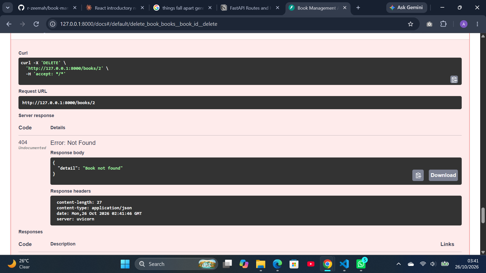

# Book Management API

## Project Description
A REST API for managing books. It supports creating, reading, updating and deleting books and filtering by genre. Books are stored in memory, so data resets when the server restarts.

## Features
- POST /books: add a book
- GET /books: list all books 
- GET /books/{book_id}: get one book
- PUT /books/{book_id}: update a book
- DELETE /books/{book_id}: delete a book

## Technologies Used
Python, FastAPI, Uvicorn, Pydantic

## Installation and Setup
git clone https://github.com/r-zeemah/book-management-api.git
cd book-management-api
python -m venv venv
venv\Scripts\activate
pip install -r requirements.txt

## How to Run the Project
uvicorn main:app --reload

## API Documentation and Screenshots
Open http://127.0.0.1:8000/docs for the interactive docs.

